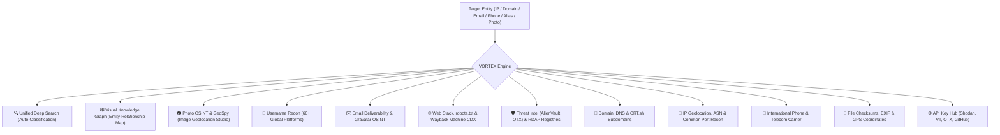

# ◈ VORTEX OSINT // Advanced Investigation & GeoSpy Suite (v2.5)

**VORTEX OSINT** is an advanced desktop graphical Open Source Intelligence (OSINT) suite built with Python, CustomTkinter, and Matplotlib. It delivers deep, multi-threaded passive reconnaissance across social identities, web archives, DNS infrastructure, threat intelligence feeds, ICANN RDAP registries, network IP geolocations, telephony records, forensic EXIF metadata, and a dedicated **Photo OSINT & GeoSpy-style Geolocation Studio**.

---

## ⚡ Investigation Modules & Capabilities



| Module | Navigation | Core OSINT Capabilities |
| :--- | :---: | :--- |
| **Unified Deep Search** | 🔍 | **Auto-detects target format** (IP, Domain, Email, Phone, or Handle) and routes across all engines with real-time classification badges and consolidated reporting. |
| **Visual Knowledge Graph** | 🕸️ | Interactive **orbital node-and-edge visual maps** connecting targets, resolved IPs, subdomains, mail servers, and tech stacks. Exportable to high-res PNG. |
| **Photo OSINT & GeoSpy** | 📷 | **Image Geolocation Studio**: Live preview thumbnail, EXIF GPS extractor with one-click Google Maps / Earth 3D / OSM launchers, environmental biome classification, vegetation & soil indices, difference hashing (dHash), reverse image search launchers (Google Lens, Yandex, Bing, TinEye), GeoGuessr country clue reference, and automated AI Geo-Dossier prompt generation. |
| **Username Footprint** | 👤 | Concurrently scans **60+ global platforms** (GitHub, Reddit, Docker, Steam, Telegram, LeetCode, Medium, Spotify, Kaggle, Mastodon, Bluesky, etc.) with clickable direct profile links. |
| **Email Intelligence** | ✉️ | RFC syntax validation, **authoritative MX server checks**, disposable/burner inbox detection, free webmail identification, and **Gravatar digital footprint** extraction. |
| **Web Stack & Archives** | 🌐 | Queries the **Internet Archive Wayback Machine CDX API** for historical URLs, parses `robots.txt` forbidden endpoints, extracts `security.txt` policies, and fingerprints web tech (CMS, JS Frameworks, CDNs, Trackers). |
| **Threat Intel & RDAP** | 🛡️ | Queries authoritative **ICANN RDAP / RIR** registries for registration dates, expiration, and nameservers. Probes **AlienVault OTX (Open Threat Exchange)** for threat pulses and malicious tags. |
| **Domain & DNS Infra** | 📡 | Authoritative DNS records (`A`, `AAAA`, `MX`, `NS`, `TXT`, `DMARC`), **Certificate Transparency logs (CRT.sh)** for live subdomains, HTTP security headers (`HSTS`, `CSP`, `X-Frame-Options`), and SSL certificates. |
| **IP & Geolocation** | 📍 | Physical geolocation, ISP, Organization, Autonomous System (ASN), Reverse DNS (PTR), and non-blocking multi-threaded **quick port scanner** on common service ports. |
| **Phone Telephony** | 📱 | ITU-T E.164 standardization, international & national formatting, **telecom network carrier identification**, line classification (Mobile, Landline, VoIP, Toll-Free), and timezones. |
| **File & EXIF Forensics** | 📁 | Extracts camera/device metadata and embedded **GPS coordinates** with a one-click Google Maps launcher, plus cryptographic hashes (**MD5 & SHA-256**). |
| **API Keys & Settings** | ⚙️ | Secure local storage (`data/config.json`) for optional API keys (AlienVault OTX, Shodan, VirusTotal, AbuseIPDB, GitHub) with one-click portal links and Google Dorking cheat-sheets. |

---

## 📷 Photo OSINT & GeoSpy Geolocation Features

The dedicated **Photo OSINT** module incorporates modern Bellingcat and GeoGuessr investigative methodologies:
1. **Live Visual Preview & Fingerprinting**: Computes 64-bit difference hash (`dHash`) to identify cropped or re-uploaded versions across the web.
2. **EXIF GPS Coordinates**: Reads exact latitude/longitude when present and provides instant links to:
   - Google Maps
   - Google Earth 3D
   - OpenStreetMap
3. **Environmental Biome Analysis**: Computes vegetation index (green cover %), arid soil/sand index, urban concrete/asphalt index, and sky tone % to classify the biome (e.g. Temperate, Arid/Savanna, Alpine/Snow, Dense Urban).
4. **Reverse Image Search Hub**: Instant one-click direct launchers for:
   - **Google Lens**
   - **Yandex Images** (exceptional for Eastern Europe, CIS, and facial/landscape accuracy)
   - **Bing Visual Search**
   - **TinEye Reverse Search**
5. **GeoGuessr Country Clues Database**: Reference guide covering driving orientation, utility pole types (e.g., Brazilian ladder poles, Polish hollow poles, Australian Stobie poles), license plate color banners, road line styles, and regional topography.
6. **AI Geo-Dossier Prompt Generator**: One-click generation of structured forensic prompts containing all extracted dimensions, biomes, lighting conditions, and clue questions, ready to paste into Gemini 1.5/2.0, Claude, or GPT-4o.

---

## 🛠️ Project Structure

```text
e:\PROJECTX/
├── main.py                     # Primary GUI application entry point
├── run.bat                     # Double-click Windows launcher
├── requirements.txt            # Project dependencies
├── README.md                   # Complete documentation
├── data/
│   ├── config.json             # API keys and engine configuration
│   └── disposable_domains.json # Disposable / burner domain blacklist
├── core/
│   ├── config.py               # Config & API key manager
│   ├── photo_osint.py          # Photo OSINT, dHash, biome analysis & GeoGuessr data
│   ├── username_recon.py       # Concurrent username footprint scanner (60+ platforms)
│   ├── email_recon.py          # Email syntax, MX, disposable, and Gravatar OSINT
│   ├── web_intel.py            # Wayback Machine CDX, robots.txt, tech stack fingerprinting
│   ├── threat_intel.py         # ICANN RDAP registries & AlienVault OTX threat pulses
│   ├── graph_builder.py        # Matplotlib entity-relationship knowledge graph
│   ├── ip_recon.py             # IP Geolocation, ASN, Reverse DNS, Port scanner
│   ├── domain_recon.py         # Authoritative DNS, CRT.sh subdomains, SSL, headers
│   ├── phone_recon.py          # International phone parsing, carrier, line type
│   ├── metadata_recon.py       # File hashes, EXIF tags, GPS coordinate extraction
│   └── exporter.py             # JSON, CSV, and TXT report generation
└── gui/
    ├── app.py                  # Main CustomTkinter window & sidebar navigation
    ├── theme.py                # Cyber dark palette, styling tokens, fonts
    ├── components/
    │   └── widgets.py          # StatCard, ResultLogBox, Action buttons
    └── views/
        ├── unified_view.py     # All-in-one smart investigation view
        ├── graph_view.py       # Visual OSINT knowledge graph view
        ├── photo_osint_view.py # Photo OSINT & GeoSpy geolocation studio view
        ├── username_view.py    # Username search view with live progress
        ├── email_view.py       # Email intelligence view
        ├── web_intel_view.py   # Web tech stack & Wayback archive view
        ├── threat_intel_view.py# Threat intelligence & RDAP registry view
        ├── domain_view.py      # Domain and DNS recon view
        ├── ip_view.py          # IP and port scan view
        ├── phone_view.py       # Phone intelligence view
        ├── metadata_view.py    # File metadata & EXIF view
        └── settings_view.py    # API keys, Dorks cheat-sheet & external portals
```

---

## 🚀 Getting Started

Launch the suite with:
- **Terminal:**
  ```powershell
  python e:\PROJECTX\main.py
  ```
- **Windows Explorer:** Double-click [`run.bat`](file:///e:/PROJECTX/run.bat).
